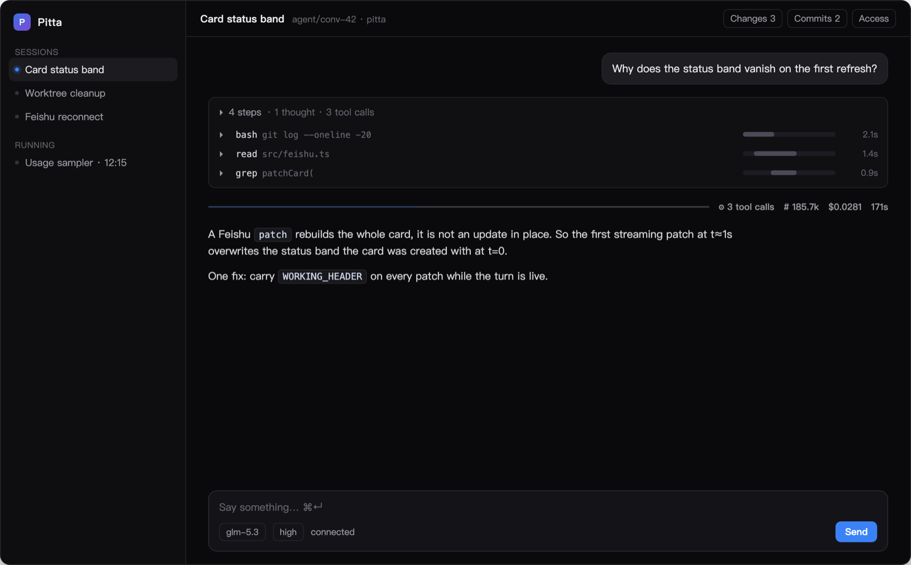
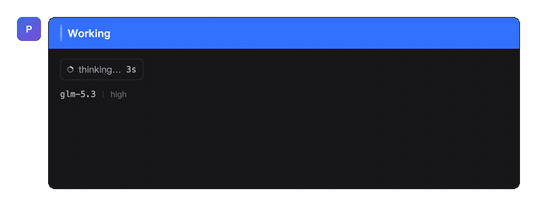
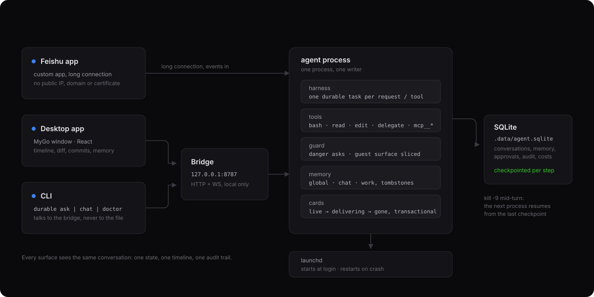

# pitta

**English** · [中文](README.zh-CN.md)

A personal assistant that runs on [Pi Durable](https://earendil.com/posts/pi-durable/): talk to it in Feishu, watch it work in a desktop app, use it from a terminal — and if the process dies, the conversation does not.





- **Engine** — `@earendil-works/pi-durable` 1.5.2. Every model request, tool call and compaction is a durable task that checkpoints before it runs. `kill -9` mid-turn, restart, and it continues from where it stopped.
- **Models** — `@earendil-works/pi-ai`. Any built-in provider; model and thinking level are switchable per conversation.
- **Storage** — one SQLite file (`.data/agent.sqlite`), one writer process, restored as-is on restart.
- **Three surfaces** — a Feishu app (long connection: no public IP, domain or certificate), a MyGo desktop app (Go window + React), and the `durable` CLI.



## What it does

| | |
|---|---|
| Feishu | One conversation per chat. In groups it answers only when @-mentioned, in a topic, so the main timeline stays clean; a follow-up inside that topic forks its own conversation. |
| Desktop | Conversations with their own git worktree each, streaming render, a step timeline with per-step gantt bars, and panels for diff, commits, usage, memory and access. |
| Model | `/model` opens a card to switch the conversation's model; `/model <id>`, `/model thinking high`, `/model default <id>` also work. Only the owner may use it. Each answered card names the model, thinking level, tokens and cost of that turn. |
| Input | Text, images (Feishu image/post messages, pasted screenshots), voice (local whisper). |
| Interrupt | `/stop` or the client's stop button. Background tasks keep running. |
| Notifications | A Feishu card answer is an *update*, and Feishu does not notify on updates. So a turn longer than 45 s also sends one short message (`✅ done · 53s` plus the first line), in the same topic. `FEISHU_DONE_PING_SECONDS` tunes it, `0` turns it off. |

### The card says how it ended

A patch in Feishu rebuilds the whole card, so the status band has to be sent with every refresh — otherwise it disappears on the first streaming update.

| band | meaning |
|---|---|
| blue `Working` | the turn is running |
| green `Done` | answered (says so when the turn needed a continuation) |
| orange `Stopped at N steps` | hit `AGENT_MAX_TURNS`, progress kept |
| grey `No answer this time · reason` | ended without an answer |
| red `Failed` | the turn threw |

The orange and grey cards carry a **Continue** button: it runs the same turn again inside the *same card*, and a double tap still starts only one turn. The card's Continue and `/continue` in `durable chat` are the same path. A turn's steps fold into the card as `Turn details · 5 steps · 62s · $0.0031`, so there is no second "view details" message.

### The run timeline

A turn reads as steps, not a log:

```
▸ 4 steps · 1 thought · 3 tool calls
  ▸ ● bash · cd ~/work/example-cli && timeout 90 node dist   ▬▬▬▬───   8.50s
  ▸ ● bash · python3 - <<'EOF' import json,re …                ▬──────   2.07s
  ▸ ● thought                                                      ─────     —

──── ▬▬▬▬▬▬▬▬  ⚙ 3 tool calls  # 185.7k  💰 $0.0281  🕐 171s ────
        ↑ waiting for your approval (amber) · thinking (blue) · tools (grey) · failed (red)
```

Each step is `tool · its first meaningful argument`, with a mini gantt bar placed at its start time and sized by its duration; the footer is the phase breakdown plus tool count, tokens, cost and total. Waiting on an approval counts toward the total, so "why did this take 171 s" is answerable at a glance.

While a turn runs, the window cannot look finished: the client derives one `turnState()` (`idle / thinking / tool / streaming / settled`) and every component reads it. Between tool calls, with nothing running and no text yet, that state is `thinking` and the seconds keep climbing.

### Sessions and projects

- **project** = a git repository on this machine; the bundled `workspace/` is the default one and cannot be removed.
- **chat** = a conversation inside a project, with its own worktree at `<project>/.worktrees/conv-<id>` on branch `agent/conv-<id>`.
- Each conversation records its **fork point** and **current base**; the base can be changed, and cleaning up a worktree with unmerged commits is refused.

### Code

Diff panel (per-file fold, +/− colouring, one-key commit, `--no-ff` merge back to the base), commit panel (branch vs base, patch view, push then a GitHub compare / GitLab MR link), read-only file view with line numbers, and a review loop: comment on diff lines, they are collected and sent to the agent in one go. Tool output renders by shape — JSON highlighted, logs coloured by level, TSV as a table, diffs in a diff view.

`workspace/` and every `.worktrees/` directory are written to the repository's own `.git/info/exclude`: `git status` stays clean, and the user's `.gitignore` is never touched.

### Memory

| layer | holds | injected |
|---|---|---|
| `global_memory` | stable facts and preferences about you | last 60 |
| `chat_memory` | context for this conversation | last 20 |
| `work_memory` | project and environment details | only an index line; found via `recall` |

Tools `remember(scope)`, `forget`, `recall`. Per-chat notes use `/memo`, `/memo add …`, `/memo del 2`, `/memo clear`, which write that conversation's `chat_memory`. Deleted memories go to `app/memory-tombstones` so the model cannot resurrect them, and deduplication uses character bigram similarity, so a rephrasing is still recognised. The client's "tidy up 24h" reads recent conversations and produces *suggestions* only; nothing is written until you tick it.

### Access and cost

One level per chat, in `app.chat-access`: `closed`, `owner` or `group`. Chats listed in `.env` are pinned to `owner`; `/allow` (or `/open`) opens a group to everyone as `group`; `/close` puts it back to `closed` without editing `.env`. Validation, guest policy, tool surface and the commands all read that one value.

| who | may talk when | tool surface (enforced in code) | memory |
|---|---|---|---|
| you (`FEISHU_ALLOWED_SENDER_IDS`) | chat is allowed | everything; dangerous calls raise an approval card in your DM | all layers |
| anyone else in an allowed group | the group was opened | `read` (workspace and this conversation's project, sensitive files refused), `skill`, `recall`, `remind`, `project_search`, `logs_query` (read-only) | this chat only |
| nobody has authorised the chat | level is `closed` | no reply; you get one card with a single button | — |

- **`FEISHU_ALLOWED_SENDER_IDS` is required.** It defines both "who is the owner" and "who may tap an approval". Empty means no owner, so the Feishu bridge refuses to start and says why.
- **The guest surface is code, not prompt text.** A non-owner turn gets the tools above and nothing else: `bash`, `write`, `edit`, `feishu_*`, `mcp__*` and `delegate` are refused in `beforeTool`. Memory has the same fence: a guest turn neither reads `global_memory` nor writes outside its chat.
- Every message carries its speaker (`[owner …]` / `[member …]`). The model does not trust the prompt's claim about identity; it reads the annotation, and the tool surface follows it.
- **Approvals** land in your DM, not the group. The decision is stored in a durable memo, so a restart does not ask again; only the listed open_ids can tap it; **nobody tapping within 10 minutes means denied**, through the same callback as a manual deny, and the card says so. The same pending approval appears in the client's amber bar; either place decides, and with no approval channel at all the answer is no.
- **Allow all in this conversation** is remembered per risk class (`rm`, `force-push`, `write-outside`, `chmod-777`, …) in `app.session-grants` and survives a restart; other conversations and other risk classes still ask.
- **Audit**: denials, level changes, approval outcomes and the two read-only queries each write one line to `app.audit` (ring of 300), readable with `durable audit`.
- **Budget**: `pi.usage` is summed into a daily cap (`AGENT_DAILY_BUDGET_USD`); over it, new requests are refused until the day rolls over.

### Scheduled work

`remind` creates a durable reminder task: the deadline is in the database, the task sleeps, and a restart does not lose it. Running tasks show in the client's left rail with a status dot and their next fire time, and a finished turn raises a native notification when the window is in the background.

### Extensions

Skills are scanned from `./.pi/skills`, `./.agents/skills`, `~/.pi/agent/skills`, `~/.agents/skills`, `~/.claude/skills`; only names go into the prompt and the `skill` tool fetches a body on demand. MCP servers from `mcp.json` (stdio or streamable HTTP) are connected at startup and their tools registered as `mcp__<server>__<tool>`. `delegate`, `delegate_parallel` and `build_feature` run sub-agents as task-owned conversations: they resume after a crash, abort in cascade, and nest one level. Feishu-native tools (`feishu_agenda`, `feishu_tasks`, `feishu_create_task`, `feishu_doc_read`) go through a locally logged-in `lark-cli`, so they act as you.

## Configuration

Everything lives in `.env`; `.env.example` explains every key.

| key | what it does |
|---|---|
| `FEISHU_APP_ID`, `FEISHU_APP_SECRET` | the Feishu app; without them the bridge does not start |
| `FEISHU_ALLOWED_SENDER_IDS` | who is the owner — required, and the only people who may approve |
| `FEISHU_ALLOWED_CHAT_IDS` | chats pinned to `owner` level (empty: every chat starts `closed`) |
| `AGENT_OWNER_NAME` | the name the prompt uses for the owner; wording only, never a permission |
| `FEISHU_DONE_PING_SECONDS` | extra completion message for turns longer than this; `0` off |
| `AGENT_PROVIDER`, `AGENT_MODEL`, `AGENT_THINKING` | default provider, model and thinking level |
| `MAGPIE_BASE_URL`, `MAGPIE_API_KEY` | when `AGENT_PROVIDER=magpie`: a local OpenAI-compatible proxy |
| `AGENT_WORKSPACE`, `AGENT_DB` | the directory tools may touch, and the SQLite file |
| `AGENT_MAX_TURNS` | tool calls per turn before the card offers Continue |
| `AGENT_DAILY_BUDGET_USD` | daily spend cap, `0` for none |
| `AGENT_WORKTREE`, `AGENT_SKILLS_DIRS`, `AGENT_MCP_CONFIG` | worktree mode, skill directories, MCP config file |
| `AGENT_HTTP_PORT`, `AGENT_HTTP_HOST`, `AGENT_HTTP_TOKEN` | the local bridge the client and CLI use; `0` disables it |
| `SLS_LOGSTORE_PREFIX` | for `logs_query`: the logstore is named `<prefix>-<env>-stdout` |
| `AGENT_ASR` | local whisper transcription: `auto` or `off` |

## Install

macOS (launchd and the desktop client are macOS-only), Node 22+, `git`. `ffmpeg`, `whisper` and
`lark-cli` are optional extras for transcription, voice messages and the native Feishu tools.

```bash
git clone https://github.com/ziludev/pitta.git && cd pitta
./bin/durable setup
```

`setup` walks six steps and stops where you would otherwise guess:

1. **Node and dependencies** — checks the version, runs `npm install` if `node_modules` is missing.
2. **The model gateway** — DeepSeek, OpenAI, Anthropic, or a local OpenAI-compatible proxy. It asks
   for the key and the model id and writes both into `.env`.
3. **The Feishu app** — App ID and App Secret from 凭证与基础信息.
4. **Your open_id** — this is what makes you the owner. Left blank, every member of every group the
   bot joins would count as you, able to tap approvals and run code.
5. **A read-back of the console** — credentials, bot capability, delivery mode, published version,
   subscribed events, `card.action.trigger`, scopes, and whether the bot is in any chat. Each ✗ says
   which menu fixes it.
6. **launchd** — hands the job over so it starts at login and restarts after a crash.

What to click in the Feishu developer console (open.feishu.cn → your app):

| Menu | Set |
|---|---|
| 添加应用能力 | 机器人 |
| 权限管理 | `im:message`, `im:message:send_as_bot`, `im:message.p2p_msg:readonly`, `im:message.group_at_msg:readonly`; add `im:message.group_msg` if you want topic replies without an @mention |
| 事件与回调 → 订阅方式 | **使用长连接接收事件** — no public IP, domain or certificate |
| 事件与回调 → 回调 | `card.action.trigger` (the approval and Continue buttons) |
| 事件与回调 → 事件 | `im.message.receive_v1` |
| 版本管理与发布 | 创建版本 → 申请发布. An unpublished change is not a change |

Then:

```bash
durable doctor            # the same read-back, any time
./scripts/agentctl logs   # what the agent is doing
./scripts/agentctl status # pid, runs, exit code
```

**Why there is no one-click Feishu setup**: a Feishu custom app is tenant-scoped — its App ID and
secret can only be created by you, inside your own tenant (crossing tenants means an ISV app, an
OAuth flow and a marketplace review). So the automated part stops exactly at that wall: everything
after the two credentials is scripted and verified. Colleagues in the same tenant can share one app
and each run their own instance; the owner list decides who controls what.

### Desktop client

```bash
cd client
npm install
npm run dev          # Go window + Vite HMR
npm run build        # build/darwin-arm64/Pitta.app and a .dmg
npm run install-app  # the same build into /Applications
```

Front end: shadcn/ui **Nova** (`radix-nova`) with Tailwind v4, Lucide icons, Motion, `react-resizable-panels`, dnd-kit, Zustand, next-themes.

## CLI

```bash
ln -sf "$PWD/bin/durable" ~/.local/bin/durable

durable                 # command overview
durable setup           # guided install: deps, gateway, Feishu, checks, launchd
durable doctor          # local and Feishu checks
durable ask "…"         # one question, streamed
durable chat            # multi-turn REPL (/new /stop /exit)
durable sessions        # conversations: id, source, project, title
durable approvals       # pending approvals; durable approve <id> / deny <id>
durable access          # each conversation's level and where approval cards go
durable audit [n]       # the last n permission decisions
```

Conversation commands go through the local HTTP/WS bridge, so they work while launchd owns the process. The name is `durable` because `agent` belongs to grok's CLI.

## Operations

```bash
./scripts/agentctl install          # render the plist and load it
./scripts/agentctl install-backup   # a hot SQLite backup every day at 04:10
./scripts/agentctl start|stop|restart|status
./scripts/agentctl logs [n]
./scripts/agentctl doctor           # node/git, .env, DB, writer lock, process count, port, restarts, worktrees
./scripts/agentctl backup|backups|restore <file>
```

- The plist is a template (`launchd/*.plist.tmpl`) rendered at install time, so a different machine needs no edits.
- Backups: `sqlite3 .backup`, then `journal_mode=DELETE` to collapse it to one file, an integrity check, 14 kept; a restore stops the process and waits for it to really exit.
- **One storage, one writer.** `.data/agent.owner` is created exclusively (`wx`) with the pid; a second process errors out instead of corrupting a live conversation. A **recycled pid does not block startup**: besides `kill(pid, 0)`, the command line from `ps -p <pid> -o command=` must look like `node … main.ts`. Before this, a hard kill could leave the lock pointing at somebody else's process and launchd would retry forever — which looks exactly like "it did not start after a reboot".
- **A broken storage heals itself.** Once a session reports `Session failed after a storage error`, only a new process can recover it, so the bridge exits and lets launchd start a fresh one; at most once per 10 minutes (`.data/storage-selfheal`), so a truly corrupt database cannot become a restart loop.
- Logs: `logs/agent.log`, `logs/agent.err.log`, `logs/backup.log`. A `[report] <time> <kind>` line is a failure inside a hook, tool or listener — it never reaches the harness, so it is only visible here.
- `agentctl doctor` judges relative to the previous run: restarts as `+N since last check`, errors only from the last two days, and untimestamped old log lines counted separately so they cannot keep posing as a new fault.

## Layout

```
src/
  main.ts          entry: bridge, Feishu, graceful exit (a harness failure exits so launchd restarts)
  server.ts        local HTTP/WS bridge: the only door for the client and the CLI
  harness.ts       Harness.open, extensions, chat↔conversation map, project/base resolution
  feishu.ts        long connection, card streaming, buttons, images and voice, commands, budget gate
  approval.ts      the guard hook: recognise a dangerous call, ask
  approvals.ts     the pending-approval registry shared by the Feishu card and the client
  access.ts        one level per chat (closed/owner/group), guest policy, owner DM
  cards.ts         pending card records and their phase (live → delivering → gone)
  details.ts       per-turn steps, seconds and cost, stored for the client
  memory.ts        three memory layers; curator.ts suggests, never writes
  settle.ts        setting a final state: "already terminal / abort-marked / session closed" is not an error
  reminders.ts     durable reminder tasks (sleepUntil) and the remind tool
  projects.ts      projects, conversation↔project/base binding
  worktree.ts      one worktree and branch per conversation; merge back to the base
  git-info.ts      commits, a single patch, push, PR/MR links
  changes.ts       workspace status, unified diff, commit
  subagents.ts     delegate / delegate_parallel / build_feature
  diagnostics.ts   the two read-only tools guests get: project_search (rg, project scope), logs_query
  audit.ts         the ring of permission decisions (app.audit)

evals/             the offline bench: guard (approval decisions) and contract (config ↔ .env.example ↔ README)
client/            MyGo app: main.go (window and bindings) + src/ (Transcript, TurnRail, Composer, SidePanel, store)
```

## Behaviours that have been observed

| case | result |
|---|---|
| crash and resume | `kill -9` halfway through `sleep 10`; the new process marks the tool call interrupted, the model retries it in the background and answers |
| reminders across processes | process A sets a 45 s reminder and exits, process B opens the same storage, it still fires |
| restart keeps state | conversation ids, memory, conversation↔project, conversation↔card registrations all unchanged |
| no re-delivery on restart | a "still running" card does not re-post the previous answer: the claim (`live → delivering`) happens inside a transaction, and only one process can take it |
| recycled pid | startup proceeds when `.data/agent.owner` names a pid now owned by something else (`ps` must show `node … main.ts` to refuse) |
| approval | `rm -rf` is refused, "allow" on the card or the client API approves it, the tool really runs, and the wait is counted in the timeline |
| worktree isolation | a file written in conversation A is invisible in the main tree and other conversations; after `--no-ff` it appears |
| unmerged guard | cleaning up a worktree whose branch has unmerged commits is refused (`unmerged, commits: 1`) |
| images | a Feishu `post` message with a 60 KB JPEG is downloaded and described correctly |
| sub-agents | designer → implementer → tester runs end to end (`33 passed`), billed separately and resumed after a crash |
| writer lock | a second process gets `storage … is owned by pid N` |

## Tests and evals

```bash
npm test                      # pure logic, node --test, seconds
npm run eval                  # guard and contract, no model needed
npm run eval -- --strict      # count known gaps as failures
npm run eval -- --json        # one envelope, for scripts
```

`tests/` pins function behaviour; `evals/` pins **contracts** — `approvalReason()` against 58 real commands, and whether `config.ts`, `.env.example` and `README.md` still agree with each other. The metric that matters is **escapes**: dangerous calls that ran with nobody asked. Known holes are not hidden — a case is marked `gap: true`, listed in the output, red under `--strict`, and the bench tells you to delete the marker once it passes. On its first run it caught nine keys missing from `.env.example` and one wrong default. See `evals/README.md`.

## Known limits

- Tests cover pure logic and contracts, not end to end; both commands run in seconds.
- A turn stops after 80 tool calls (`AGENT_MAX_TURNS`). That is not a failure: the card says it stopped at the limit and offers Continue; the transcript is intact.
- Pi Durable is **experimental** and changes between 1.x releases; run `npm run typecheck` before upgrading. It also pins chord: from 1.5.1 chord v2 is the package root, `Context` lives only in `@earendil-works/chord/context`, and importing it from the root fails to compile.
- SQLite runs with `synchronous=NORMAL`: a crash loses nothing, a power cut may lose the last commit.
- `bash` can in principle `cd` out of the workspace; the guard hook covers danger, it is not a sandbox.
- One-click Feishu setup across tenants is impossible (see the CLI section).
- Usage squares start on the day the sampler first ran; there is no per-day history before that.
- This is a personal assistant, not a product: prompt text and some UI copy are Chinese, and the owner is a single hard-coded name.

## License

MIT. See [LICENSE](LICENSE).
