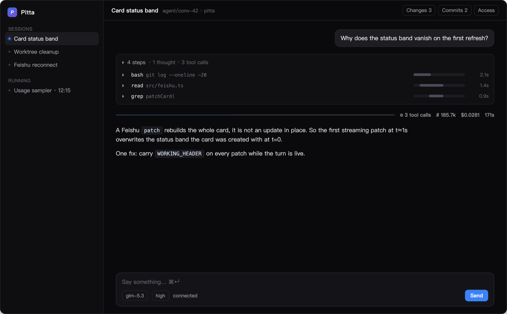
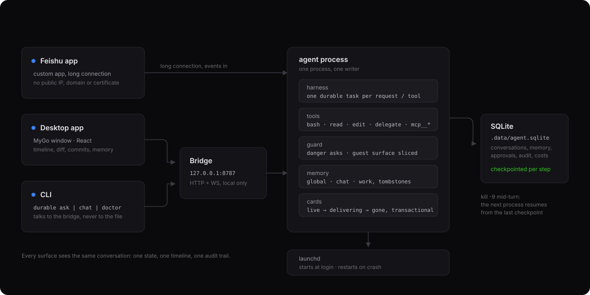

# pitta

[English](README.md) · **中文**

跑在 [Pi Durable](https://earendil.com/posts/pi-durable/) 上的个人助理：飞书里聊、桌面上看、终端里也能用，进程挂了不丢对话。




- **引擎**：`@earendil-works/pi-durable` 1.5.2。每个模型请求、每次工具调用、每次压缩都是一个 durable task，每步先落 checkpoint；进程被 `kill -9`，重启后从断点继续。
- **模型**：`@earendil-works/pi-ai`。默认走本机 magpie 代理（OpenAI 兼容），可换任意内置 provider；模型/思考级别可**逐会话**切换。
- **存储**：SQLite（`.data/agent.sqlite`），单进程独占，重启原样恢复。
- **三个入口**：
  - 飞书自建应用（长连接，不需要公网 IP / 域名 / 证书）
  - `client/`：MyGo 桌面 app（Go 窗口 + React + shadcn/ui Nova）
  - `durable`：CLI



---

## 能力

### 对话

| | |
|---|---|
| 飞书 | 群/单聊各自一个 conversation；群里 @ 才响应；**被 @ 就回在话题里**（群里不刷屏），话题里的追问 → 该话题独立 fork |
| 客户端 | 自建会话（每个自动分配 git worktree）、流式渲染、步骤时间线（见下） |
| 模型 | 飞书里 `/model` 一张卡片换本会话模型（也可 `/model <id>`、`/model thinking high`、`/model default <id>`，只有主人能发）；卡片底部那行写明本轮用的模型、thinking 档、token 与花费 |
| CLI | `durable ask "…"` / `durable chat`（REPL）、`durable sessions` |
| 输入 | 文字、图片（飞书 image/post 消息；客户端粘贴截图）、语音（本地 whisper） |
| 中断 | `/stop`、客户端停止按钮；后台任务不受影响 |
| 完成提醒 | 答案只是**原地更新卡片**，飞书不会为"更新"推送通知。所以一轮超过 45 秒时，收尾会额外发一条短消息（`✅ 答完了 · 53s` + 结论前 60 字），这样锁屏也能收到；话题里的提问，这条也发在同一个话题里。`FEISHU_DONE_PING_SECONDS` 可调，设 0 关闭 |
| 卡片状态 | 卡片顶部一直写着这轮处在哪：蓝 `⏳ 处理中` → 绿 `✅ 答完了`（续跑过一次写「续跑一次」）/ 橙 `⏸️ 到了 80 步上限` / 灰 `⚠️ 这次没答出来 · 原因` / 红 `❌ 出错了`。飞书的 patch 是**整张重建**，所以每次刷新都重新带上 header，否则状态条会在第一次流式刷新后消失 |
| 没答完能接着跑 | 橙卡和灰卡带一个「继续」按钮，点它在**同一张卡片**里续跑；连点只跑一次（注册表里先认领再提交）。卡片上的「继续」和 `durable chat` 里的 `/continue` 走同一条路径 |
| 执行详情 | 步骤时间线默认折叠在卡片里（`本轮执行详情 · 5 步 · 62s · $0.0031`），不再单发一条「查看详情」消息；客户端是一条可展开的步骤条 |

### 运行时间线（参考 Detent UI / ThinkRail 的表达）

一轮回复被拆成可读的步骤，而不是一坨日志：

```
▸ 4 个步骤 · 思考 ×1 · 3 次工具调用
  ▸ ● bash · cd ~/work/example-cli && timeout 90 node dist   ▬▬▬▬───   8.50s
  ▸ ● bash · python3 - <<'EOF' import json,re …                  ▬──────   2.07s
  ▸ ● 思考                                                          ─────     —

──── ▬▬▬▬▬▬▬▬  ⚙ 3 次工具调用  # 185.7k  💰 $0.0281  🕐 171s ────
        ↑ 阶段占比：等你确认（琥珀）/ 思考（蓝）/ 工具（灰）/ 失败（红）
```

- 每步 = `工具 · 第一个有意义的参数`，右侧是该步在整轮里的**迷你甘特条**（位置=起始时间，长度=耗时）
- 轮末是阶段占比条 + 工具数 + token + 花费 + 总时长
- 「等你确认」的审批等待也会计入（数据来自 `app/approval-waits`），所以"这轮为什么 171 秒"能一眼归因
- **跑着的时候窗口不会自己看起来停了**：客户端只有一个 `turnState()`（`idle / thinking / tool / streaming / settled`），判定一次、渲染各处读它。工具调用之间没工具在跑、也还没出字，就是 `thinking` 并带着秒数往上走；轮末那条统计条在跑的时候显示 spinner +「运行中」，不是总结
- **连接状态也是一个显式联合**（`connecting / open / down{reason:error|closed}`），每个 socket 带代数，切会话时旧 socket 迟到的 `onclose` 不会再给新会话盖上"已断开"

### 会话与项目

- **project** = 本机一个 git 仓库（内置 `workspace/` 是默认项目，删不掉）；ThinkRail 的 project → workspace → chats
- **chat** = 项目里的一个会话，自动 `git worktree add` 到 `<project>/.worktrees/conv-<id>`，分支 `agent/conv-<id>`
- 每个会话记录 **fork 点**和**当前基线**，基线可改（换成别的分支会提示"会把它上面的提交也算进来"）
- 会话可重命名 / 归档 / 清理 worktree（有未合并提交时拒绝清理）

### 代码

| | |
|---|---|
| 改动面板 | 工作区 diff，逐文件折叠、+/− 着色、一键提交、`--no-ff` 合并回基线 |
| 提交面板 | 本会话分支相对基线的 commit 列表，展开看 patch，推送后给出 PR/MR 链接（GitHub compare / GitLab MR） |
| 文件视图 | 点文件名 → 带行号的只读视图 |
| 评审回路 | 点 diff 行留意见 → 收集 → 一次性发给 agent |
| 工具输出 | 按形状渲染：JSON 高亮、日志按级别着色、TSV/表格成表、diff 走 diff 视图 |

`workspace/` 及每个 project 的 `.worktrees/` 都写进仓库自己的 `.git/info/exclude`，不污染 `git status`，也不动用户的 `.gitignore`。

### 记忆

三层，作用域决定是否进入 prompt：

| 层 | 内容 | 注入 |
|---|---|---|
| `global_memory` | 关于你的稳定事实、偏好 | ✅ 最近 60 条 |
| `chat_memory` | 当前对话的上下文事实 | ✅ 最近 20 条 |
| `work_memory` | 项目/环境细节 | ❌ 只留一行索引，靠 `recall` 搜 |

- 工具：`remember(scope)` / `forget` / `recall`
- **群专属记忆**（飞书命令，owner 可改，群里所有人受益）：`/memo` 看、`/memo add 本群代号是金刚狼` 加、`/memo del 2` 删第 2 条、`/memo clear` 清空。写的就是该会话的 `chat_memory`，每次回答自动注入；guest 群也能用（只影响本群，不碰全局记忆）
- **手动整理**：右栏「记忆 → 整理 24h」读最近会话，只产出**建议**（带 scope + 理由），你勾选后才写入；`global` 每次最多 3 条
- 删除过的记忆进 `app/memory-tombstones`，不会被模型"复活"；去重用字符 bigram 相似度（换说法也能识别）

### 安全与成本

- **群里也能用 `/allow`**：飞书把 @ 渲染成 `@_user_1` 记号，之前替换成 `@` 后 `/allow` 变成 `@ /allow`，所有斜杠命令在群里都失效（单聊没 @ 所以看不出来）。现在先取到 bot 自己的 open_id，@ 它时整段去掉；找不到身份时命令匹配也会剥掉开头的 @ 前缀
- **本会话内全部允许**：卡片和客户端都有这个按钮。它按**风险类**（`rm` / `force-push` / `write-outside` / `chmod-777`…）在**当前会话**内记住，存在 `app.session-grants`，重启后仍有效；别的会话、别的风险类照样会问。风险类 key 有单测钉住，"同一个炸点不会被反复问，也不会一次放行所有危险操作"
- **有审计**：拒绝（guest 越界用工具）、级别变更、审批结果、两个只读查询各记一条，存在 `app.audit`（环形 300 条），`durable audit` 直接看；`durable doctor` 会打印每个会话的级别，桌面端侧栏「权限」页查看同一份数据
- **审批**：`guard` hook 拦危险调用（`rm -rf`、`git push --force`、`sudo`、写工作区外…），**卡片发到你的私聊**（不再发在群里，群里只会看到“等主人确认”）；decision 存 durable memo，重启不重问。只有 `FEISHU_ALLOWED_SENDER_IDS` 里的 open_id 能点。**10 分钟没人点按拒绝处理**，和手点拒绝走同一条回调，卡片上写清是超时
- **同一份待审批**同时出现在飞书卡片和客户端（底部琥珀条），任一处都可决定；**fail closed**（没有审批通道时默认拒绝）
- **审批等待**会记录时长并计入该轮时间线
- **额度**：`pi.usage` 汇总 → 每日上限（`AGENT_DAILY_BUDGET_USD`），超了拒绝新请求，跨天重置
- **一个群一个级别**：`app.chat-access` 里只有三档——`closed`（不对任何人）/ `owner`（只对你）/ `group`（所有人，guest 待遇）。`.env` 里列的 chat 是 `owner`（只在没存过级别时生效）、`/allow` 和卡片打开的是 `group`。校验、guest 策略、工具面、`/allow` 全读这一个值（以前是 `.env` + `app.allowed-chats` + `app.guest-chats` 三套加一条派生规则）
- **guest 群**：`/open`（或 `/allow`）把群开放给所有成员，该会话的记忆**只到本群为止**——不注入 `global_memory`，`remember` 只能写 chat 作用域，`recall` 搜不到你的全局/工作记忆，`forget` 也删不到（这三个是同一道门，`ChatPolicy.guest`）
- **guest 的工具面是代码拦的，不是提示词**：非主人的回合只给 `read`（限工作区 + **本会话所在项目**，`.env`/`.data`/`.ssh`/`.git`/`*.pem`/`*secret*` 一律拒）+ `skill` + `recall` + `remind` + **`project_search`（rg，限项目内）** + **`logs_query`（SLS 只读，dev 和 prod 都能查——读不是风险，写才拦）**；`bash`/`write`/`edit`/`feishu_*`/`mcp__*`/`delegate` 全部在 `beforeTool` 里挡掉并回一句「guest 模式不支持」。以前这些只是写在 instructions 里，群里任何人都能让它 `cat .env`
- **`/allow` 一步到位**：在群里发 `/allow` 不只是加白名单，而是直接把本群开成 guest 模式（和 `/open` 同一套保护，`/open` 多一条「只答本群主题」）。所以之后群里任何人 @bot 都能用，**不会再按人给你发授权卡**——授权这个群就是授权群里的人
- **写权限看「谁在问」，记忆看「这个群」**：guest 群的每一条消息都会按发送者重设 instructions——你自己的回合是「按他说的改文件、推分支、触发部署都可以」，别人的回合才是只读。记忆则不管谁问都不放（共享群的 transcript 大家都看得到）
- **`FEISHU_ALLOWED_SENDER_IDS` 是必填的**：它同时定义“谁是主人”和“谁能点审批”。为空时旧的逻辑是**人人都是主人**（能 `/allow`、能点审批、能拿到可写指令），现在启动时直接跳过飞书桥并打印原因（桌面端与 CLI 照常可用），`durable doctor` 也会报红
- **每一条消息都自带说话人**：`[主人本人 ou_abcde] …` / `[群成员 ou_9abc1] …`。模型不信 prompt 里那句「我是主人」，但会认消息上的标注；工具面也按这个标注走（`ChatPolicy.turn`）
- **还是会拒绝时自动纠一次**：同一个群被旧规则拒绝过好几轮后，光改 instructions 不够（模型会顺着自己之前的拒绝往下说）。这时网关会自动补一句「你刚才那条作废、写权限是开的」再问一遍（只在主人回合、且这轮确实没写过文件时触发，一条消息只补一次）
- **陌生人不会被静默丢掉**：它没见过的会话不会得到回复，但会给你发一张卡（来源、会话 id、发送者 open_id、前 200 字），上面只有一个按钮：**开放此会话（guest 权限）**，点一下把级别设成 `group`。以前这一步要两张卡（先授权会话、再授权人）
- **`.env` 里列的群 / 单聊被显式固定成 `owner` 级别**：那里只有你能问，其他人会收到一句「这个会话只对主人开放。发一句 /allow 可以让这里所有人都能用」——不再逐人发卡
- **`/allow` 开、`/close` 关**：`/close` 把级别改回 `closed`，不用改 `.env` 重启。两者都只有你能发
- 你自己的 p2p 会话 id 是第一次发消息时记下的（`app/owner-chat`），因为陌生人的会话 id 事先不可能知道

| 谁 | 能说话的条件 | 工具面（代码强制） | 记忆 |
|---|---|---|---|
| 你（`FEISHU_ALLOWED_SENDER_IDS`） | chat 在白名单（`.env` 或 `/allow`） | 全开；危险调用弹审批卡到你的私聊 | 全量 |
| 群里的其他人 | 群已 `/allow`（guest 群） | `read`(限工作区+本会话项目、排敏感文件) + `skill` + `recall` + `remind` + `project_search` + `logs_query`(dev + prod，只读) | | 只本群 |
| 单聊里的人（卡片授权后） | 那个会话是 `group` 级别 | 同上 | 只本群 |
| 谁都没授权 | 会话级别 `closed` | 不回应，只给你发一张卡（一个按钮） | — |

### 主动性

- `remind` 工具创建 **durable 定时任务**：deadline 落库、任务睡觉、重启后照样到点触发
- 左栏「运行中」显示后台任务 + 红黄绿状态点 + 触发时刻（`● 伸个懒腰 12:15`）
- 客户端窗口在后台时，一轮回答结束发原生通知

### 扩展

| | |
|---|---|
| Skills | 扫描 `./.pi/skills`、`./.agents/skills`、`~/.pi/agent/skills`、`~/.agents/skills`、`~/.claude/skills`（与 pi 一致，另加 Claude Code 目录）。prompt 只放名字，`skill` 工具按需取全文 |
| MCP | `mcp.json` 里的 servers（stdio / streamable HTTP）启动时连接，工具注册为 `mcp__<server>__<tool>` |
| 多角色 | `delegate` / `delegate_parallel` / `build_feature`；每个子 agent 是 task-owned conversation，崩了续跑、abort 级联、只允许一层 |
| 飞书原生 | 走本机已登录的 `lark-cli`（你的用户身份）：`feishu_agenda` 日历、`feishu_tasks` 待办、`feishu_create_task`、`feishu_doc_read` |

---

## 配置

都在 `.env` 里，每个键的说明见 `.env.example`。

| 键 | 作用 |
|---|---|
| `FEISHU_APP_ID`、`FEISHU_APP_SECRET` | 飞书自建应用；缺了飞书桥不启动 |
| `FEISHU_ALLOWED_SENDER_IDS` | 谁是主人 —— 必填，也只有这些人能点审批 |
| `FEISHU_ALLOWED_CHAT_IDS` | 固定成 `owner` 级别的会话（留空则每个会话都从 `closed` 开始） |
| `AGENT_OWNER_NAME` | 提示词里怎么称呼主人；只影响措辞，不影响权限 |
| `FEISHU_DONE_PING_SECONDS` | 超过多少秒额外发一条完成消息；`0` 关闭 |
| `AGENT_PROVIDER`、`AGENT_MODEL`、`AGENT_THINKING` | 默认 provider、模型、思考档 |
| `MAGPIE_BASE_URL`、`MAGPIE_API_KEY` | `AGENT_PROVIDER=magpie` 时的本机代理地址与 key |
| `AGENT_WORKSPACE`、`AGENT_DB` | 工具能碰的目录，和那个 SQLite 文件 |
| `AGENT_MAX_TURNS` | 一轮多少步工具调用后停住并给出「继续」 |
| `AGENT_DAILY_BUDGET_USD` | 每日花费上限，`0` 不限 |
| `AGENT_WORKTREE`、`AGENT_SKILLS_DIRS`、`AGENT_MCP_CONFIG` | worktree 模式、skill 目录、MCP 配置 |
| `AGENT_HTTP_PORT`、`AGENT_HTTP_HOST`、`AGENT_HTTP_TOKEN` | 客户端与 CLI 用的本机桥；`0` 关闭 |
| `SLS_LOGSTORE_PREFIX` | `logs_query` 的 logstore 名是 `<prefix>-<env>-stdout` |
| `AGENT_ASR` | 本地 whisper 转写：`auto` 或 `off` |

## 安装

macOS（launchd 与桌面端只做了 macOS），Node 22+，`git`。`ffmpeg`、`whisper`、`lark-cli` 是可选扩展：
语音转写、语音消息、飞书原生工具。

```bash
git clone https://github.com/ziludev/pitta.git && cd pitta
./bin/durable setup
```

`setup` 走六步，正好覆盖容易卡住的几处：

1. **Node 与依赖** —— 检查版本；`node_modules` 不在就跑 `npm install`。
2. **模型网关** —— DeepSeek / OpenAI / Anthropic / 本机 OpenAI 兼容代理；问 key 和模型 id，写进 `.env`。
3. **飞书应用** —— 凭证与基础信息里的 App ID、App Secret。
4. **你的 open_id** —— 这条决定谁是主人。留空的话，机器人所在每个群的每个人都算主人，能点审批、能改代码。
5. **把控制台读回来** —— 凭证、机器人能力、订阅方式、已发布版本、已订阅事件、`card.action.trigger`、权限、机器人是否已在某个会话；每个 ✗ 都写明去哪个菜单改。
6. **launchd** —— 交出去，开机自启、崩溃重启。

飞书开发者后台要点的（open.feishu.cn → 你的应用）：

| 菜单 | 设置 |
|---|---|
| 添加应用能力 | 机器人 |
| 权限管理 | `im:message`、`im:message:send_as_bot`、`im:message.p2p_msg:readonly`、`im:message.group_at_msg:readonly`；想在话题里不 @ 也回复，再加 `im:message.group_msg` |
| 事件与回调 → 订阅方式 | **使用长连接接收事件**（不需要公网 IP、域名、证书） |
| 事件与回调 → 回调 | `card.action.trigger`（审批与「继续」按钮） |
| 事件与回调 → 事件 | `im.message.receive_v1` |
| 版本管理与发布 | 创建版本 → 申请发布。不发布等于没配 |

之后：

```bash
durable doctor            # 同一套读回校验，随时可跑
./scripts/agentctl logs   # 看 agent 在做什么
./scripts/agentctl status # pid、runs、退出码
```

**为什么没有「一键装飞书应用」**：飞书自建应用是租户内的，App ID 和 Secret 只能你自己在自己的租户里建
（跨租户就意味着做 ISV 应用、走 OAuth 和审核上架）。所以自动化停在墙前一步：拿到两个凭据之后的所有事都脚本化并校验。
同租户的同事可以共用一个应用、各跑各的实例，谁能控制什么由主人名单决定。

### 桌面客户端

```bash
cd client
npm install
npm run dev      # 开发：Go 窗口 + Vite 热更新
npm run build        # 产出 build/darwin-arm64/Pitta.app 与 .dmg
npm run install-app  # 同一份装进 /Applications（应用列表里能看到）
```

前端栈：shadcn/ui **Nova**（`radix-nova`）+ Tailwind v4 · Lucide 图标 · Motion 动效 · react-resizable-panels 三栏 · dnd-kit 会话排序 · Zustand 状态 · next-themes 主题。

---

## CLI

```bash
ln -sf "$PWD/bin/durable" ~/.local/bin/durable   # 放到 PATH

durable                 # 命令总览
durable setup           # 引导式安装：依赖、网关、飞书凭据、体检、launchd
durable doctor          # 本地 + 飞书双侧体检
durable ask "…"         # 一次性提问（流式）
durable chat            # 多轮 REPL（/new /stop /exit）
durable sessions        # 会话列表（id / 来源 / 项目 / 标题）
durable approvals       # 待审批；durable approve <id> / deny <id>
durable access          # 每个会话的访问级别（closed / owner / group）+ 审批卡发往哪里
durable audit [n]       # 最近 n 条权限决定：谁、哪个会话、什么级别、拦了什么、谁批的
```

命令名是 `durable` 而不是 `agent`：`agent` 已被 grok 的 CLI 占用。

对话类命令走**本机 HTTP/WS 桥**，所以 launchd 托管着 agent 时也能用，不需要停进程。

**关于「一键授权飞书」**：飞书自建应用是租户级的，App ID/Secret 只能本人在自己租户的开发者后台创建（跨租户要发布成 ISV 商店应用并过审）。所以 CLI 自动化的是创建之后的一切——写配置、校验每个开关、启动、诊断。同租户的同事可以共用一个应用、各自跑实例。

---

## 运维

```bash
./scripts/agentctl install          # 渲染 plist 并装载（开机自启 + 崩溃重启）
./scripts/agentctl install-backup   # 每天 04:10 的 sqlite 热备份
./scripts/agentctl start|stop|restart|status
./scripts/agentctl logs [n]
./scripts/agentctl doctor           # 本地自检（node/git、.env、DB、写者锁、进程数、端口、launchd 重启次数、worktree）
./scripts/agentctl backup|backups|restore <file>
./scripts/agentctl uninstall
```

- plist 是模板（`launchd/*.plist.tmpl`），`install` 时渲染实路径，换机器不用手改
- 备份：`sqlite3 .backup` 热备 → `journal_mode=DELETE` 收成单文件 → 完整性校验 → 保留 14 份；恢复会先停进程、等它真正退出
- **一份 storage 只能一个进程写**：`openRuntime()` 用 `wx` 独占创建 `.data/agent.owner`（pid），第二个进程直接报错而不是把运行中的会话搞坏。**pid 被系统复用不会挡住启动**：除了 `kill(pid,0)`，还要 `ps -p <pid> -o command=` 里确实是 `node … main.ts` 才认（硬杀或重启后，那个号可能已经归别人；以前这种情况 launchd 会一直重启失败，看起来就是"开机后进程没起来"）
- **写坏了会自己重开**：storage 一旦报 `Session failed after a storage error`（比如撞上重复 id），session 就永久废了——只有重开进程能救。所以 bridge 遇到这种错误会直接 `exit`，让 launchd 起新进程；10 分钟内不重复触发（标记在 `.data/storage-selfheal`），避免真的坏库变成重启死循环
- 日志：`logs/agent.log`、`logs/agent.err.log`、`logs/backup.log`；`[report] <时间戳> <kind>` 是 hook/tool/listener 的失败（不会抛进 harness，只能在这看）
- `doctor` 的判据是**相对量**：重启次数与上次体检比（`+N since last check`），错误只看近两天；旧日志里没有时间戳的行单独计数，不会永远冒充"新故障"

---

## 结构

```
src/
  main.ts          进程入口（bridge + 飞书 + 优雅退出；harness 失败即退出让 launchd 重启）
  server.ts        本机 HTTP/WS 桥：客户端和 CLI 的唯一入口
  harness.ts       Harness.open、扩展装配、chat↔conversation 映射、project/base 解析
  feishu.ts        长连接、卡片流式、审批按钮、图片/语音、命令、额度闸门
  cli/main.ts      `durable` 子命令；cli/feishu-check.ts 是飞书侧体检
  personal.ts      人设 / 时间 / 工作区 section
  roles.ts         子 agent 角色：指令 + 工具白名单 + 轮次上限
  subagents.ts     delegate / delegate_parallel / build_feature（durable 子会话）
  settle.ts        任务收尾：写终态时把「已经是终态 / 已被中止 / session 已关」当成正常，别的错照样抛
  memory.ts        global / chat / work 三层记忆 doc、remember/forget/recall
  curator.ts       手动整理：读会话 → 只产出建议
  reminders.ts     durable Reminder task（sleepUntil）+ remind 工具
  approval.ts      guard hook：危险调用识别 + 审批
  approvals.ts     审批注册表（飞书卡片与客户端共用）
  budget.ts        每日花费 doc + 闸门
  usage-days.ts    按日 usage 采样（后台 durable 任务）+ 方块图数据
  projects.ts      project 列表、会话↔项目/基线绑定
  worktree.ts      每会话一个 git worktree/分支；merge 回基线
  git-info.ts      commit 列表、单 commit patch、push、PR/MR 链接
  changes.ts       工作区 status + unified diff + 提交
  skills.ts        SKILL.md 扫描（名进 prompt，全文按需取）
  mcp.ts           MCP client，把 server 的工具注册成 durable 工具
  lark-tools.ts    飞书原生工具（走 lark-cli 用户身份）
  asr.ts           本地 whisper 转写（ffmpeg + whisper）
  access.ts        一个 chat 一个级别（closed/owner/group）+ guest 策略 + 主人私聊；guest.ts / allowed.ts 已合并进来
  diagnostics.ts   给 guest 用的两个只读工具：project_search（rg 限项目）、logs_query（SLS，prod 需主人本人）
  audit.ts         权限决定的环形审计（app.audit）：拒绝/级别变更/审批/查询
  surface-meta.ts / threads.ts / cards.ts / details.ts
  live.ts / log.ts / similar.ts / channel.ts / runtime-ref.ts / storage-lock.ts / models.ts

evals/             离线评测台：guard（审批判定）+ contract（config↔.env.example↔README），`npm run eval`

client/            MyGo 桌面 app
  main.go          Go 窗口 + 绑定（桥接地址/token、agentctl 控制、原生通知）
  src/components/  Transcript / TurnRail（步骤时间线）/ Composer / SideRail / SidePanel（改动·提交·用量·记忆）…
  src/store.ts     Zustand：会话/条目/live/记忆/改动/审批/项目/语言
  src/lib/turn-state.ts  一轮渲染成什么（idle/thinking/tool/streaming/settled），窗口自己没有第二套判断
```

---

## 实测过的行为

| 场景 | 结果 |
|---|---|
| 崩溃续跑 | `sleep 10` 跑到一半 `kill -9`，新进程把工具调用标为中断，模型改后台重跑并答完 |
| 跨进程提醒 | A 进程设 45s 提醒后退出，B 进程打开同一 storage，到点照样触发 |
| 重启保持 | conversation id、记忆、会话↔项目映射、会话↔卡片登记都不变 |
| 重启不重投 | 重启后一张「本轮还在跑」的卡片不会把上一轮的答案再发一遍：认领（`live→delivering`）在 transaction 里，两个进程只有一个能拿到 |
| pid 被复用 | `.data/agent.owner` 里的 pid 已被别的进程占用时照常启动（`ps` 校验命令行为 `node … main.ts` 才拦） |
| 工具审批 | `rm -rf` 被拦 → 飞书卡片点「允许」/ 客户端 API 允许 → 工具真实执行；等待时长计入时间线 |
| worktree 隔离 | 会话 A 写文件，主树与其他会话看不到；合并 `--no-ff` 后出现在主树 |
| 未合并保护 | 清理 worktree 时分支有未合并提交 → `unmerged, commits:1` 拒绝 |
| 图片 | 飞书 `post` 图文消息 → 下载 60KB JPEG → 模型准确描述截图内容 |
| 子 agent | designer → implementer → tester 全跑通，`33 passed`；子会话独立计费、崩了续跑 |
| 存储写者锁 | 第二个进程 `openRuntime()` 直接报 `storage … is owned by pid N` |

---

## 测试与评测

```bash
npm test                      # 纯逻辑单测（node --test），秒级
npm run eval                  # 离线评测：守卫判定 + 配置/文档契约，不需要模型
npm run eval -- --strict      # 让「已知缺口」也算失败
npm run eval -- --json        # 一个 envelope，给脚本读
```

- `tests/` 钉函数行为，`evals/` 钉**契约**：`approvalReason()` 对 58 条真实命令的判定，以及 `config.ts` / `.env.example` / `README` 三者还对不对得上
- 最要紧的指标是**逃逸**：危险调用没人问就跑了。已知漏洞不装看不见——case 标 `gap: true`，输出里列出来、`--strict` 变红，修好后自动提示删掉那行
- 第一次跑就抓到 9 处 `.env.example` 缺项（`FEISHU_DONE_PING_SECONDS`、`AGENT_HTTP_*`、`AGENT_WORKTREE` …）和 1 处默认值写错：例子还写着 `AGENT_MODEL=auto/*` 路由组，而代码注释明确说路由组会让同一个任务一天成一天败
- 详见 `evals/README.md`

---

## 已知限制

- 测试覆盖的是纯逻辑 + 契约（记忆去重、审批注册表、diff 采集、远端链接、危险命令判定、文档与配置对齐），不是端到端；`npm test` 和 `npm run eval` 都是秒级
- 一轮最多 80 步工具调用（`AGENT_MAX_TURNS`）。到上限不是出错：卡片会写「跑到 N 步上限」并提示回「继续」，transcript 都在，接着说就行。以前默认 40 步，两个真排查任务（SLS/DMS 日志、lark-cli 拉人）都死在这条线上
- Pi Durable 是 **experimental**，1.x 之间 API 会变；升级前先 `npm run typecheck`。注意 pi-durable 会连带锁死 chord 版本：1.5.1 起 chord v2 成为包根，`Context` 只在 `@earendil-works/chord/context`，从包根 import 会编译失败
- SQLite 用 `synchronous=NORMAL`：进程崩不丢，掉电可能丢最后一个 commit
- `bash` 理论上能 `cd` 出工作区；靠 guard hook 兜危险性，不是沙箱
- 跨租户"一键装飞书"做不到（见上文 CLI 一节）
- 方块图从采样器启动那天开始积累，更早的历史没有逐日数据

---

## 下一步候选

暂缓（不是紧急问题，先说清需求再动）：

- **主动性**：邮件 / 日历 / GitHub 事件触发（现在是显式指令 + 定时提醒）。要先定：哪些触发源、什么值得打断、静默时段
- **记忆向量检索**：现在是 bigram 去重 + `recall` 关键词，记忆上千条后会不够用。需要选 embedding 走哪家（magpie 代理？）并估一次重排成本

已经量过、不值得做的：

- ~~空转成本~~：`/api/state` 10–20ms / 21 个会话，占空比 0.1%，不是瓶颈

做完的（留档，避免重复讨论）：会话级花费与耗时（列表 + 头部 + 每轮柱状图）、项目移除、话题在客户端可读、飞书断线告警、纯逻辑单测

---

## 许可

MIT，见 [LICENSE](LICENSE)。
